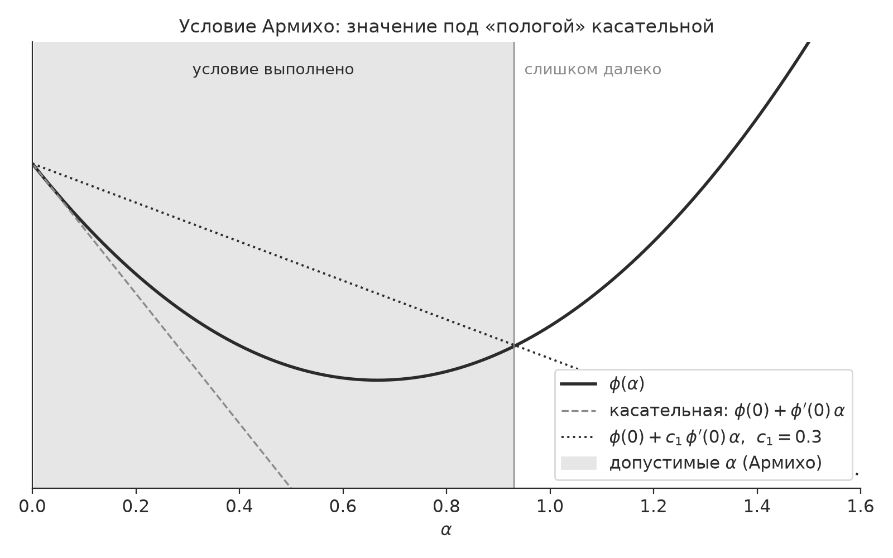

:PROPERTIES:
:ID:       15611E05-13FC-4FB0-AE00-A4BB857A29E6
:END:
#+title: Условие Армихо
#+filetags: :image:metopt:definition:

Пусть $\phi: \R \rightarrow \R$, $\phi \in C^1(\R)$ -- непрерывно [[id:957FA09D-8883-40A5-B4C7-237D9F815A42][дифференцируема]], рассмотрим отрезок $[a;b]$, такой что $\phi^{\prime}(a) < 0$
Зафиксируем $0 < c_1 < 1$.

Тогда условие Армихо:
\[
\phi(\alpha_k) <  \phi(a) + c_1(\alpha_k - a) \cdot \phi^{\prime}(a)
\]

* Интерпретация
Если мы возьмем касательную в точке $a$ и сделаем ее более пологой (это умножение на $c_1$), то значение в точке $\alpha_k$ должно быть под этой прямой.

Давайте представим, что локально функция напоминает параболу, тогда из этого ограничения следует, что если мы перейдем в точку $\alpha_k$, и она окажется на противоположной ветке параболы, то она должна находиться не слишком высоко.  То есть мы не должны уйти слишком далеко от минимума.

Это защищает от того, чтобы мы слишком долго прыгали между левой и правой ветками и не могли сойтись.

* Anki :noexport:
:PROPERTIES:
:ANKI_DECK: Notes::metopt
:END:
** Условие Армихо: интерпретация
:PROPERTIES:
:ANKI_NOTE_TYPE: Basic
:ANKI_NOTE_ID: 1791617146775
:ANKI_NOTE_HASH: 499134533d3075f976c4fc271fee4e11
:END:
*** Front
Метопт. Как геометрически прочитать условие Армихо \(\phi(\alpha_k) \lt \phi(a) + c_1(\alpha_k - a)\phi'(a)\)?
*** Back
Касательную в \(a\) делаем более пологой (наклон умножаем на \(c_1\)); значение в \(\alpha_k\) должно лежать под этой прямой — нельзя уйти слишком высоко на другую ветку.
