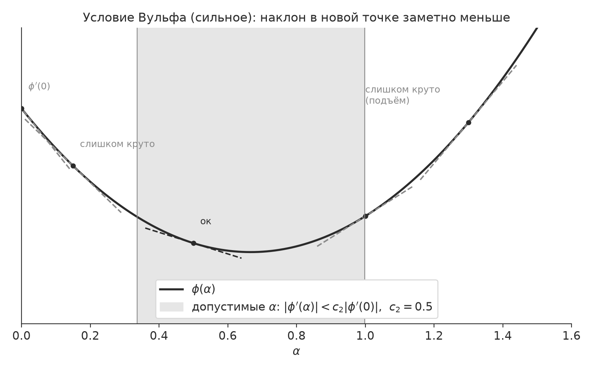

:PROPERTIES:
:ID:       2084FD2F-E2AA-4081-B9D1-14CEA27EA243
:END:
#+title: Условие Вульфа
#+filetags: :image:metopt:definition:

Пусть $\phi: \R \rightarrow \R$, $\phi \in C^1(\R)$ -- непрерывно [[id:957FA09D-8883-40A5-B4C7-237D9F815A42][дифференцируема]], рассмотрим отрезок $[a;b]$, такой что $\phi^{\prime}(a) < 0$
Зафиксируем $0 < c_2 < 1$.

Условие Вульфа:
\[| \phi^{\prime}(\alpha_k) | < c_2|\phi^{\prime}(a)|
\]

* Интерпретация

Это условие говорит нам, что в следующей точке касательная должна быть более пологая, чем в этой. Причем умножение на $c_2$ усиливает это условие. То есть новая точка должна оказаться там, где наклон заметно меньше, -- ближе к минимуму.

Получается, что это условие говорит нам: если мы выбрали $\alpha_k$ на той же ветке, то мы хотя бы должны спуститься по этой ветке достаточно глубоко. То есть мы должны прыгнуть достаточно далеко.

* Anki :noexport:
:PROPERTIES:
:ANKI_DECK: Notes::metopt
:END:
** Условие Вульфа: интерпретация
:PROPERTIES:
:ANKI_NOTE_TYPE: Basic
:ANKI_NOTE_ID: 1791617146777
:ANKI_NOTE_HASH: 523b47a7b98067e0a00e733b9c414de1
:END:
*** Front
Метопт. Как геометрически прочитать условие Вульфа \(|\phi'(\alpha_k)| \lt c_2|\phi'(a)|\)?
*** Back
В новой точке касательная заметно более пологая, чем в \(a\): мы спустились по ветке достаточно глубоко, ближе к минимуму.
